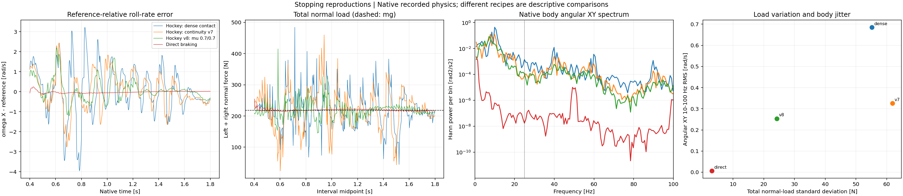
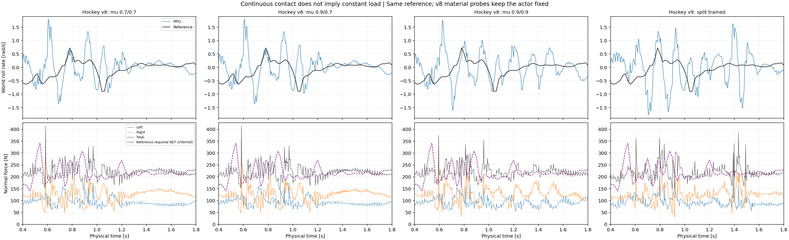

# Reference-relative PPO jitter and normal-load variation

Eleven archived nominal PhysX reproductions show extra motion relative to their
kinematic references. Average total normal load stays close to the robot's
218.50 N weight even in the strongly oscillating runs. Load fluctuations,
left/right load transfer and body angular oscillation describe different
effects; neither average load nor continuous touching alone measures smoothness.

All numbers below use the turning core 1.44–4.00 s or stopping core 0.40–1.80 s.
Angular jitter is native world-X/Y angular-velocity RMS in 10 < f < 100 Hz,
using linear detrending, a Hann window and channel-mean power. The reference
has only 50 Hz samples. Reference-relative error therefore uses the narrower
10 < f < 20 Hz band; signals above 25 Hz are reported as native dynamics,
without claiming knowledge of unsampled reference motion. No phase fitting
or time warping is used.

| Reproduction | Native angular jitter (rad/s) | Reference-relative 10–20 Hz error (rad/s) | Total normal-load SD (N) | Native force peak (N) |
|---|---:|---:|---:|---:|
| Turn, beta ON, 200 Hz | 2.172 | 1.000 | 283.78 | 1550.71 |
| Turn, beta OFF, 200 Hz | 1.870 | 0.604 | 242.84 | 1525.34 |
| Turn, action-rate −0.5, 200 Hz | 1.169 | 0.954 | 225.12 | 1467.48 |
| Same actor, 400 Hz | 0.948 | 0.851 | 276.33 | 2328.13 |
| Hockey, dense contact reward | 0.685 | 0.639 | 55.17 | 484.57 |
| Hockey, continuity v7 | 0.326 | 0.294 | 61.84 | 460.16 |
| Hockey v8, 0.7/0.7 | 0.254 | 0.233 | 24.25 | 415.25 |
| Same v8 actor, 0.9/0.7 | 0.255 | 0.235 | 24.55 | 415.03 |
| Same v8 actor, 0.9/0.9 | 0.226 | 0.196 | 23.76 | 374.68 |
| Split-trained hockey v9, 0.9/0.7 | 0.226 | 0.196 | 29.68 | 387.23 |
| Direct braking, 0.7/0.7 | 0.00608 | 0.00144 | 3.13 | 254.45 |



The hockey reference's own 10–20 Hz angular RMS is 0.04424 rad/s. For v8 the
actual value is 0.23661 and the tracking-error value is 0.23348 rad/s. The
extra oscillation therefore is not just intended reference motion. Dense,
v7 and v8 lose bilateral geometric contact for 7.5, 25 and 0 ms respectively
over the stopping core. v8, its two material probes, v9 and direct braking
all retain bilateral contact throughout the full reference. v8 still peaks
at 415 N (1.90 times weight) while continuously touching. Contact success
does not imply constant load.

From dense to v8, native angular jitter falls 63.0% and load SD falls 56.1%.
From v7 to v8, jitter falls 22.3% and load SD falls 60.8%. These are historical
recipe/budget progressions, not isolated reward interventions. Direct braking
is markedly smoother at this low speed, but has a different pose reference
and training seed. These observations do not establish that all hockey-like
motions are intrinsically worse.



The force differences have several distinct explanations:

1. **Whole-body vertical dynamics.** For the flat-floor stopping recordings,
   `N_left + N_right = M(g + a_COM,z)` to numerical precision. Using all ten
   recorded body COM velocities and the hash-locked authored masses gives
   vertical force-balance RMS residuals of 0.000046–0.000208 N. A one-native-step
   force shift raises the residual to 2.56–35.49 N. This verifies the net force
   sum and its interval timestamp. Base-link acceleration is not the whole-body
   COM acceleration; internal leg motion must be included. The check does not
   certify individual contact-patch forces or real-world tire fidelity.

2. **Load transfer and angular motion.** At v8's nominal material, mean left/right
   normal loads are 94.32/125.17 N. Their correlation is −0.433 and the
   left-minus-right load SD is 36.62 N, while total-load SD is only 24.25 N.
   Part of the variation transfers load between wheels. Roll/pitch also depend
   on contact lever arms, tangential forces and internal angular momentum, so
   total normal-load variation cannot uniquely determine body jitter. The
   split-trained v9 has 11.3% lower native angular jitter than v8 at the same
   0.9/0.7 material, yet 20.9% higher total-load SD.

3. **Contact switching versus continuous-contact oscillation.** The old turning
   records have frequent native manifold-count transitions and large force
   pulses; over 99% of their adjacent-force-change energy lies within ±20 ms
   of those transitions. These dense neighborhoods are descriptive, not a
   causal attribution. Those old records lack contact separation, so manifold
   absence must not be equated with a measured geometric airborne duration.
   The modern hockey records have geometric evidence: v8's remaining jitter
   and force peaks occur with continuous bilateral contact. Flight/landing is
   therefore not a sufficient explanation for this remaining oscillation.

4. **Physics/control timing and force readout.** The fixed action-rate −0.5 actor
   has 18.9% less angular jitter at 400 Hz than at 200 Hz, but its native force
   peak rises from 1467 to 2328 N. Integrating over identical 5 ms windows gives
   peaks of 1467 versus 1289 N; over 20 ms, 820 versus 644 N. Their 20 ms
   load SDs are 174.40 versus 171.51 N. An impulse divided by a smaller timestep
   can have a larger native peak without a larger equal-duration impulse.
   Here both the physics and explicit DC-PD update rates change, with the same
   actor and 50 Hz policy; this does not isolate solver discretization alone.
   The [PhysX tensor API](https://docs.omniverse.nvidia.com/kit/docs/omni_physics/108.0/extensions/runtime/source/omni.physics.tensors/docs/api/python.html)
   documents the impulse-to-force timestep conversion. The
   [constraint-solver documentation](https://nvidia-omniverse.github.io/PhysX/physx/5.4.1/docs/RigidBodyDynamics.html#constraint-solver)
   also explains why reported velocity need not equal pose finite differences
   under contact constraints. This audit uses native velocity records.

5. **Reference geometry and reward compromises.** The exact same hockey reference
   was previously [audited for contact gaps](../hockey_reference_contact_gap_20261029_v1/README.md):
   only 4/139 reference frames put both authored wheel cylinders within 0.1 mm
   of the floor. The policy must alter attitude/placement to maintain bilateral
   contact. This demonstrates a conflict between exact pose imitation and the
   contact target; it does not prove that this conflict alone causes jitter.
   Action-rate penalties constrain 50 Hz action changes, not every native
   contact impulse. The historical vertical smoothness term uses base COM
   velocity differences over 20 ms, whereas later contact refinements add
   physical-substep terms. None guarantees constant normal load.

The old turn beta-OFF actor has 13.9% less jitter, but core XY RMSE worsens
from 5.65 to 7.18 cm. Both have a strong native angular peak near 26 Hz. Thus
beta is neither necessary for the observed oscillation nor a complete
smoothness explanation. Historical training setup/RNG differences prevent a
strict beta-only causal conclusion. [Turn comparison](turn_comparison_4x1.png).

There is **no measured reference normal force**. The dashed reference-force
curve is only the necessary net vertical resultant inferred from the
mass-weighted 50 Hz reference COM velocity. Its hockey mean/SD is
217.88/32.75 N, not a per-wheel force target or a dynamics-feasibility result.
Normal-load variation can be appropriate for the intended motion. A future
objective should retain continuous contact and distinguish intended load
transfer from excess high-frequency motion, rather than treating either
`N_left = N_right = Mg/2` or zero load variance as physical ground truth.

[Full report and input hashes](report.json) · [case table](cases.csv) ·
[derived signals](signals.npz) · [case selection](selection.json).
Each row is one nominal archived rollout; no new policy or simulator execution
was used. Five focused numerical checks cover spectral separation, equal-time
impulse comparisons, whole-body internal-motion cancellation, timestamp
negative controls and geometric contact independent of load thresholds.

```bash
python scripts/analyze_reproduction_jitter_load.py --output outputs/reproduction_jitter_load
python -m pytest -q tests/test_reproduction_jitter_load.py
```

NumPy, SciPy and Matplotlib are required, together with the selected archived
raw recordings and references. No learned weights or simulator runtime is
needed for this offline audit.
