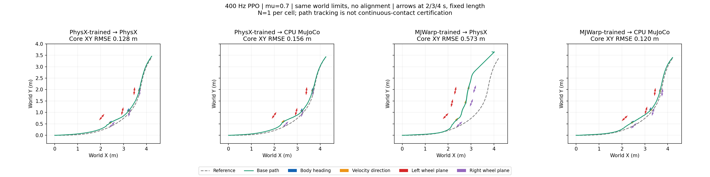
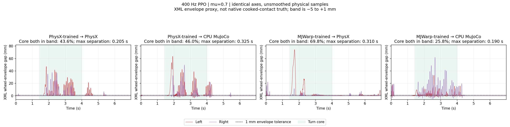
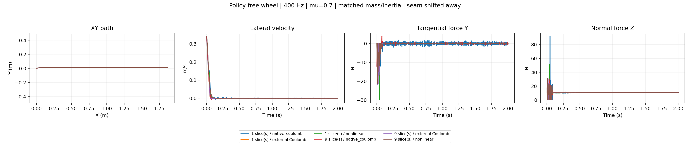

# Sliding foundations: completed evidence and running comparison

The matched 400 Hz PPO **2 training backends × 2 validation backends × 17 friction values** matrix is complete. The controlled wheel-model factorial and two same-request replay diagnostics are also complete. The matched SAC comparison has passed both learner smoke tests and all four deployment smoke tests; its formal training and validation sequence is running. This is not yet a completed sim2real or hockey-prior benefit study.

## 1. PPO backend and friction comparison



Nominal effective pair friction is **μ = 0.7**. The core window is 1.44–4.00 s. Physical simulation runs at 400 Hz and the policy at 50 Hz. Training uses action-rate weight −0.5 and the shared friction/encoder-bias/COM/push randomization recipe. Each policy has 12,288,000 training transitions, seed 42.

| Training backend | Validation backend | Core XY RMSE | Speed retention | Reference-relative β RMSE |
|---|---|---:|---:|---:|
| PhysX | PhysX | 0.128 m | 1.001 | 6.14° |
| PhysX | native CPU MuJoCo | 0.156 m | 0.993 | 8.22° |
| MuJoCo-Warp | PhysX | 0.573 m | 0.842 | 28.84° |
| MuJoCo-Warp | native CPU MuJoCo | 0.120 m | 0.977 | 5.85° |

Transfer degradation is directional in this cohort. CPU MuJoCo evaluation is explicitly **not** MuJoCo-Warp evaluation. Different contact laws, native plant parameters and closed-loop responses remain possible contributors.

The 17 tested coefficients are 0.01, 0.03, 0.05, 0.10, 0.15, 0.20, 0.30, 0.45, 0.60, 0.70, 0.80, 1.00, 1.20, 1.40, 1.60, 1.80 and 2.00. For PhysX-trained → PhysX, all six tested values at or below 0.20 exceed the exploratory XY screen; the eleven tested values at or above 0.30 pass it. Other train/evaluate combinations are nonmonotonic. These are discrete observations, not continuous feasible ranges.

The historical screen is core XY RMSE > 0.15 m **or** peak error > 0.30 m. Passing it does not establish continuous bilateral contact or successful controlled sliding. Native force-thresholded contact counts indicate load eligibility, not geometric separation. The current task requirement remains **both wheels continuously touching**; the final algorithm analysis separately reports ideal-cylinder geometric gap at 0.1, 1 and 2 mm tolerance, without relabeling load counts as geometric contact. That calculation includes the XML collider's local center and axis, not just the wheel-link origin. For PhysX it remains an XML-envelope proxy, not exact cooked-contact readback.

- [All 68 formal cells, CSV](ppo_matrix_analysis/metric_table.csv)
- [Full metrics and caveats](ppo_matrix_analysis/summary.json)
- [Friction sweep plots](ppo_matrix_analysis/friction_grid_curves.png)
- [Completion and provenance manifest](ppo_matrix_proof/validation_matrix_manifest.json)

There is **one deterministic episode per cell**. This is not a statistical success-rate estimate. The continuation reverified and copied 46 completed formal cells and four smoke cells, then executed the missing 22 cells. Old directories, source snapshots and policy weights were preserved.

The four nominal cells also have a completed, unsmoothed **contact-continuity** diagnostic:



| Training → validation | Core bilateral envelope within −5 to +1 mm | Longest core interval with any wheel gap > 1 mm |
|---|---:|---:|
| PhysX → PhysX | 43.6% | 0.205 s |
| PhysX → CPU MuJoCo | 46.0% | 0.325 s |
| MuJoCo-Warp → PhysX | 69.8% | 0.310 s |
| MuJoCo-Warp → CPU MuJoCo | 25.8% | 0.190 s |

All four exhibit repeated envelope separation under this diagnostic. The better-tracking cells therefore cannot be presented as completing the continuous-bilateral-contact requirement. These are cylinder-envelope estimates including the collider offsets, **not measured native contact probabilities**; the report also supplies 0.1 and 2 mm sensitivity results. The −5 mm lower bound rejects deep penetration rather than counting it as support. Contact-conditioned lateral-speed records are kept separately, and these recordings do not contain the per-point native normals needed to certify friction saturation. [Metrics and limitations](nominal_contact_continuity/report.json) / [derived timelines](nominal_contact_continuity/derived_continuity.npz).

Reproduce from the hash-matched nominal recordings and the pinned legacy evaluator:

```bash
python scripts/analyze_nominal_contact_continuity.py \
  --summary results/sliding_foundation_completion_20261031_v1/ppo_matrix_analysis/summary.json \
  --trace-root /path/to/nominal_physx_traces \
  --reference /path/to/frozen/motion.npz --model /path/to/frozen/mujoco_model.xml \
  --legacy-evaluator /path/to/frozen_cpu_source/scripts/eval_tracking_mujoco.py \
  --output-dir /path/to/new/contact_report
```

## 2. Policy-independent wheel-model factorial



All **18 full episodes + 6 smoke episodes** passed the force/momentum consistency gate. The factors are one cylinder versus nine contiguous coaxial slices; native Coulomb, external regularized Coulomb and nonlinear combined-slip forces; and 200/400/800 Hz. Mass, inertia, initial state, outer dimensions, 1 mm contact offset and zero rest offset are matched. The floor triangulation seam is displaced away from the test trajectory.

At 400 Hz, the first time lateral speed falls below 0.05 m/s is:

| Geometry | Native Coulomb | External regularized Coulomb | Nonlinear combined slip |
|---|---:|---:|---:|
| One cylinder | 57.5 ms | 47.5 ms | 52.5 ms |
| Nine slices | 47.5 ms | 47.5 ms | 55.0 ms |

The external controls use each native contact point's **preceding physical interval** normal load and disable native tangential friction. Their applied-force capacity denominator therefore differs from the current native-load denominator. At 400 Hz, they apply force during a total 2.5–17.5 ms with no current positive normal-force sample. That is evidence of the declared coupling delay, not proof of geometric flight or an exact built-in tire solver.

The nonlinear law has no static adhesion, bristle state or identified real-tire parameters. Slicing does not automatically improve model accuracy. These are unactuated 1.08 kg axle-fixture results; full-body historical tests are listed separately in the [evidence inventory](historical_evidence_inventory.json).

- [Full model-factor report](wheel_factor_analysis/report.json)
- [200 Hz](wheel_factor_analysis/wheel_factors_200hz.png) / [800 Hz](wheel_factor_analysis/wheel_factors_800hz.png)
- [Native traces and per-case metadata](wheel_factor_raw/status.json)
- [Download integrity manifest](completed_evidence_v1.manifest.json)

## 3. Same observable initial state and same requested actions

Each current policy's nominal PhysX requests were replayed in CPU MuJoCo without policy inference, state correction or time alignment. All six initial pose/velocity fields match to the checked tolerance; actions remain fixed for their original eight physical substeps. Wheel priorities use the same explicit native mapping as the closed-loop evaluation.

| Policy supplying the recorded requests | XY gap RMS, first 0.2 s | Actual leg-torque gap RMS, first 0.2 s | First XY gap > 0.10 m |
|---|---:|---:|---:|
| PhysX-trained | 0.333 mm | 3.01 Nm | 0.8175 s |
| MuJoCo-Warp-trained | 0.840 mm | 4.45 Nm | 0.6225 s |

Identical requested leg positions and wheel efforts do not imply identical applied leg torque: each plant recomputes PD from its own state. Hidden contact/solver state is not equated. Longer open-loop divergence is not a controller transfer success rate and does not isolate friction as the sole cause.

- PhysX-trained: [report](physx_requests_mujoco/analysis/summary.json), [plot](physx_requests_mujoco/analysis/backend_request_replay.png)
- MuJoCo-Warp-trained: [report](mjlab_requests_mujoco/analysis/summary.json), [plot](mjlab_requests_mujoco/analysis/backend_request_replay.png)

## 4. Matched SAC execution

The new SAC arms use the frozen 400 Hz task, reference, actuator contract, 15 reward terms, phase/reset distribution and representable shared DR. Each formal arm receives 512 environments × 24,000 policy steps = 12,288,000 transitions, seed 42. Smoke learners use 32 × 48 transitions and a short timeout to exercise pre-reset bootstrapping; smoke actors are not task-performance results.

SAC has twin privileged critics, replay, entropy adaptation and a deterministic tanh actor at evaluation. Its identity observation normalization differs from PPO's online RSL normalization. The comparison is between these declared algorithm recipes; it does not isolate an abstract algorithm independently of normalization, action distribution or optimizer updates.

Two learner smokes and four cross-backend deployment smokes passed. The serial sequence then trains PhysX and MuJoCo-Warp SAC and runs all 68 formal validation cells. It verifies native recording counts, actor hashes, material mappings and source identity before generating combined metrics and horizontal nominal plots. It uses only an idle GPU at launch and does not signal other users' processes.

Remote workspace:

```text
/data/zengxiong/workspaces/tron1-foundation-completion-20261031-v1/
  ppo_matrix_v1/       completed, 68 formal + 4 smoke
  wheel_factors_v2/    completed, 18 formal + 6 smoke
  sac_source_v3/       immutable ten-file code snapshot
  sac_sequence_v3/     formal training and automatic validation/reporting
    comparison_analysis_with_geometry_offsets_v1/  final analysis destination
```

Read progress without attaching to or changing the job:

```bash
/home/roy/.codex/skills/remote-compute-ssh/scripts/remote_compute.sh exec 4090d -- \
  cat /data/zengxiong/workspaces/tron1-foundation-completion-20261031-v1/sac_sequence_v3/status.json
```

The earlier stopped setup attempts are retained. The wheel queue's first attempt failed before launching a simulator because of an import path. SAC's initial deployment probe found a missing BeyondMimic source path; both already-passed learner smokes were hash-verified and reused after that deployment fix. No failed task rollout was deleted or counted as success.

The final offline pass waits for the entire SAC sequence. It corrects the preliminary analyzer's link-centered contact envelope using the named XML collider offsets (±7.07 mm along each local wheel axis) and orientations. At 20° camber, omitting that offset can create about 2.4 mm of false gap. A regression test covers this case. The preliminary contact-gap metrics are explicitly superseded; training, trajectories and tracking scores are unchanged. The completed smoke evidence and its dated training-progress observation are saved in [sac_preflight_evidence_20261031_v1.json](sac_preflight_evidence_20261031_v1.json).

## Remaining study boundaries

Real TRON1 measurements have not been collected. Sim2real gap requires synchronized commands, encoders, IMU and metric external pose, with frame/time calibration and held-out runs. Without force measurement, per-wheel cone saturation remains an estimate. The sim2sim gap is not a bound on real-world error.

The final hockey experiment must compare the human prior and an appropriate no-human-prior baseline under matched entry speed, surface, stopping target, actuator limits, transition budget and **bilateral geometric contact** criteria. Existing hockey policies and friction audits do not yet establish that prior's causal benefit. The new SAC training is on the turning reference, not relabeled as hockey-stop learning.

The authoritative stage plan is [sliding_foundation_protocol_v1.json](../../config/sliding_foundation_protocol_v1.json). No real robot motion has been scheduled or commanded.
