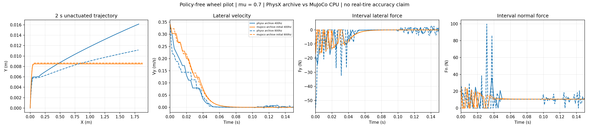

# Sliding foundation: policy-free wheel pilot

The study now separates contact-model evidence, cross-backend learning, and real-world transfer before assessing hockey-stop imitation. A TRON1 robot is available for later measurements, as confirmed by the user on 2026-10-31. No real measurements or hardware motion were performed in this stage.

The executable pilot completed **14 new MuJoCo CPU rollouts** and reused **2 hash-verified PhysX rollouts**. No new PhysX simulation or policy training was launched. At the resource check, every RTX GPU had an existing CUDA process; previously paused training was left unchanged.

## What was measured

A single unactuated wheel translates freely in XYZ and spins about world Y. X/Z rotation is locked by the axle fixture. The radius is 0.127 m, width 0.05 m, mass 1.080000043 kg, and inertia matches the archived PhysX runtime readback. Initial planar speed is 1 m/s at a 20 degree angle to the rolling direction; initial wheel speed matches the longitudinal rolling component. Each episode lasts 2 s at mu = 0.7.

The two engine pairs match the **observable initial state** at 400 or 800 Hz. Their hidden contact states are not matched. A separate 12-case MuJoCo cohort uses exactly one initial state while varying 200/400/800 Hz, elliptic/pyramidal cones, and Newton iteration budgets of 10/100. Contact softness is pinned (`solref = 0.02 1`, `solimp = 0.9 0.95 0.001 0.5 2`), with Euler integration and zero joint damping, armature and friction loss. These parameters were not fitted to the PhysX traces or to real tires.

| Quantity | PhysX archive, 400 Hz | MuJoCo CPU, 400 Hz | PhysX archive, 800 Hz | MuJoCo CPU, 800 Hz |
| --- | ---: | ---: | ---: | ---: |
| First time abs(Vy) <= 0.05 m/s | 40 ms | 45 ms | 38.75 ms | 43.75 ms |
| Final lateral displacement | 16.14 mm | 8.49 mm | 11.15 mm | 8.65 mm |
| Final forward velocity | 0.8768 m/s | 0.9394 m/s | 0.8699 m/s | 0.9394 m/s |
| Normal-force-active samples | 98.875% | 99.125% | 98.000% | 99.250% |
| Vertical momentum residual RMS | 0.284 N | < 1e-10 N | 0.475 N | < 1e-10 N |

The paired 2 s XY trajectory differences are **27.46 mm RMS at 400 Hz** and **30.09 mm at 800 Hz**. These are differences between simulator responses, not errors against reality. They combine geometry/contact representation, solver behavior, initialization and numerical effects.



The XY panel deliberately uses unequal axis scales to expose millimeter-scale lateral displacement; it is not a geometrically faithful overhead rendering. Force and velocity panels show the first 150 ms, including the initial transient. The full 2 s traces are in the NPZ artifacts.

In the controlled MuJoCo numerical cohort, 200/800 Hz and 400/800 Hz elliptic-cone XY differences are 0.595 mm and 0.399 mm RMS. Increasing the iteration budget from 10 to 100 makes no observable trajectory change in this fixture. This is a sensitivity result for this simple case, not proof of general convergence. The archive's initial Z positions differ by approximately 46 micrometers between rates, so its 400/800 Hz difference is not a pure timestep comparison.

## Measurement gate uncovered by the pilot

The archived native PhysX tangential force is inferred from `mass * delta(COM velocity) / dt`; normal force comes from the contact sensor. Interval k is paired with normal sample k+1, not the previous sample. The complete raw data remains visible.

During eligible bottom-point sliding, the largest resultant `|Ft| / (mu Fn)` is 1.99 at 400 Hz and 3.08 at 800 Hz. Both rates contain two values above 1.05, during the startup transient. The vertical momentum residual peaks at 6.18 N and 15.84 N. After the first 20 ms, the vertical RMS residual falls to 0.00645 N and 0.02845 N. This flags an unresolved initialization/force-accounting discrepancy requiring native recollection; solver corrections are another possible cause. It does **not** establish a PhysX Coulomb-law violation.

Sliding eligibility requires geometric proximity at both step endpoints, positive recorded normal force, bottom material-point tangential speed above 0.05 m/s at both endpoints, and direction agreement within 30 degrees. It does not select samples based on force direction or closeness to the cone. Geometric proximity uses a 0.1 mm tolerance. A geometric bottom-point velocity is shared across engines as a proxy; archived native friction anchors are unavailable. At 800 Hz, no eligible archived intervals remain after 20 ms, so no post-transient saturation claim is made for that case.

MuJoCo interval contact forces close translational momentum within 1.2e-11 N in the paired cases. This validates the force-frame and time bookkeeping, not the model's physical accuracy. The native contact records retain each contact position, distance, world force and pre-step material-point velocity. Frictionless controls use `condim=1` so a numerical minimum tangential coefficient is not mistaken for exactly zero friction.

The next PhysX collection must preserve native normal contacts and friction anchors, explicitly record/reset initialization state, read back solver/collision settings, and repeat timesteps from a common observable state. Geometry, force-law and external-force coupling changes must be separate factors. In particular, the older nonlinear tire arm used the previous sample's load; that delay cannot be attributed solely to the tire law.

## Experimental order and real measurements

The machine-readable [protocol](../../config/sliding_foundation_protocol_v1.json) records completed work and pending stages.

1. **Model checks:** complete the native PhysX measurement gate, then compare geometry, force law and numerical settings independently. Neither engine is ground truth. Start with mu = 0.7; keep the PhysX 0.9/0.7 static/dynamic arm separate because native MuJoCo does not provide the same two-coefficient transition.
2. **Learning and sim2sim:** begin with PPO and SAC, holding reference, observation/action semantics, reward, actuator model, timestep, representable DR and transition budget fixed. Cross training backend with evaluation backend, and use multiple training seeds. Audit historical models before reuse. MuJoCo-Warp training and MuJoCo CPU evaluation must remain explicitly distinguished. DR and adaptation are separate experimental factors, not names for different RL algorithms.
3. **Sim2real:** use separate identification and held-out measurements. Compare contact/slip timing, short state transitions and closed-loop task outcomes with uncertainty intervals. Sim2sim disagreement is not a bound on the real gap. A same-action comparison must record actual applied torques because equal PD/velocity targets need not produce equal torques.
4. **Hockey stop:** only then compare matched entry speed, surface, target and training budget, with/without the hockey motion prior and with/without a sliding objective. Require both-wheel contact and report stopping distance/time, XY error, smoothness and mechanical work. A larger beta or reward alone does not demonstrate useful sliding.

For the physical TRON1, preserve native timestamps for joint positions/velocities, wheel speed, IMU, commanded targets before/after filtering and limits, and externally measured metric base pose. Record ground-plane and coordinate-frame calibration, wheel geometry, surface condition, and drive state. Synchronization and pose uncertainty must be quantified before deriving contact-point slip. Camera-only human motion is not a substitute for robot tire measurements.

Encoders, IMU and external pose can establish contact-conditioned kinematic sliding if contact is independently verified. Direct per-wheel friction-cone capacity additionally needs force evidence, such as a synchronized force plate or suitable force sensing. Motor-current estimates need calibration and uncertainty; net body acceleration alone does not uniquely determine left/right contact forces. No direct force sensor is assumed to be present, and privileged simulation force observations need not be policy inputs.

## Reproduction and verification

Environment: local MuJoCo 3.8.1, NumPy, Matplotlib and pytest; no package installation or GPU required.

```bash
python -m pytest tests/test_wheel_backend_foundation.py -q
python scripts/benchmark_wheel_backend_foundation.py \
  --archive results/physx_tire_comparison_20261024_v1/raw/single_wheel_bench_collection_v1.tar.gz \
  --manifest results/physx_tire_comparison_20261024_v1/raw/single_wheel_bench_collection_v1.manifest.json \
  --output-dir /tmp/wheel_backend_foundation_reproduction
```

Five physical checks passed: frictionless lateral momentum, same-interval force balance, left/right reflection symmetry, exclusion of airborne sliding, and detection of a deliberately shifted force signal. Each selected archive member is verified against its manifest before loading. The [report](pilot/report.json) records source, XML and trace hashes, parameters, metrics and limitations.

References: [MuJoCo contact model](https://mujoco.readthedocs.io/en/stable/computation/index.html), [MuJoCo contact-force API](https://mujoco.readthedocs.io/en/stable/APIreference/APIfunctions.html#mj-contactforce), and [Contact Models in Robotics](https://arxiv.org/abs/2304.06372). These motivate separating model assumptions, numerical behavior and measurement validity; they do not validate the current tire parameters.
