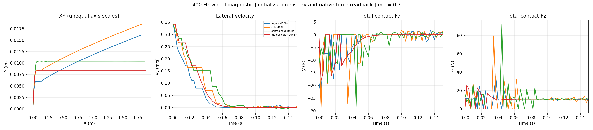
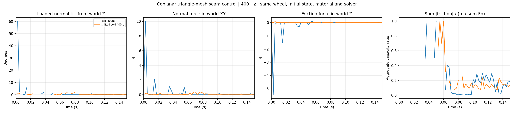

# Native contact forces and ground-mesh sensitivity

The single-wheel force discrepancy is explained by **tilted native contact normals**, not by a changed trajectory or unmatched initialization history. Translational momentum closes when the complete native normal and friction vectors are included. Moving the coplanar ground-mesh seam away from the wheel also substantially reduces the PhysX–MuJoCo trajectory difference.

This is a contact-model diagnostic, not a new policy-training result or a real-tire validation.

## Completed work

- At the user's request, the paused old hockey dispatcher and trainer were terminated. Both exited after SIGTERM; neither required SIGKILL. Saved weights and logs were preserved. The last `model_400.pt` retains SHA-256 `72a56a0ee49c8a92e2eb6e1889a6589db0d4bb422c0504251a441231bf294fc0`.
- GPU 1 was verified to have no CUDA process before each new diagnostic. Runs were serial; no other process was signalled by the diagnostic runner.
- Completed 12 full 2 s PhysX cases and 3 short 40 ms smoke tests. The first smoke passed, but its suite stopped on a stale GPU utilization reading after process exit. The revised guard waits up to 60 s for that reading to expire while continuing to reject any existing CUDA process. No failed simulation was silently retried.
- Compared six matched-initial-state MuJoCo CPU conditions. All 12 local buffer, resource-guard and physics tests passed.

## Why the previous force calculation was misleading

The archived and recollected legacy runs at 400/800 Hz have **exactly identical stored root-state arrays**. Their normal-force Z recordings also agree within floating-point precision. The earlier error was treating the world XY component of total contact force as friction and treating world Z as every contact's normal direction.

The correct momentum balance is

\[
 m\frac{v_{k+1}-v_k}{\Delta t}
 = mg + \sum_i f_{n,i}n_i + \sum_j f_{t,j}.
\]

In the original 400 Hz legacy fixture, a loaded contact normal tilts up to 40.01 degrees from world Z. Friction consequently has a world-Z component reaching 6.184 N; normal force also contributes to world XY. At 800 Hz, the corresponding extrema are 87.64 degrees and 15.840 N. Those vertical friction components explain the old apparent vertical momentum imbalance. These extrema occupy a small part of the trace and are not representative mean loads.

Using the complete vectors, the largest per-axis momentum RMS residual across all full cases is **0.000132 N**. Deliberately shifting force by one sample increases the residual substantially. No transient is removed to obtain the aligned result.

Capacity is now screened using `sum(norm(native friction anchors)) / (mu * sum(native scalar normal loads))`. The maximum across these cases is approximately **1.00000025**. This is a necessary aggregate check: native friction-anchor to normal-patch correspondence is still unavailable, so it is not a per-patch Coulomb or maximum-dissipation certificate. The previous `|m delta v_XY / dt| / (mu F_Z)` values must not be interpreted as friction-cone violations for this mesh fixture.

## Initialization and geometry controls

Three initialization conditions were run at 200/400/800 Hz:

1. The legacy sequence: settle, reset pose, advance one step, then write velocity.
2. A fresh scene with no prior contact, replaying the exact legacy root state.
3. A fresh scene with one common initial root state at all three timesteps.

Legacy and matched-state fresh runs produce identical stored trajectories at all three rates. This rejects initialization history as the explanation for this particular discrepancy; it does not establish that contact history is irrelevant in other tasks.

The geometry control keeps the same horizontal two-triangle mesh, dimensions, wheel, initial state, friction, collision offsets, inertia and solver settings, but translates the mesh by -5 m in Y. Its internal diagonal moves from `y=x` to `y=x-5`, away from the complete wheel trajectory. The wheel remains far from the mesh perimeter. The model's ground remains flat at Z=0; only its placement relative to the triangulation changes.

| Physics rate | Maximum loaded normal tilt, original / shifted mesh | PhysX–MuJoCo 2 s XY RMS, original / shifted mesh |
| --- | ---: | ---: |
| 200 Hz | 6.04 / 1.73 degrees | 31.57 / 7.79 mm |
| 400 Hz | 60.23 / 2.16 degrees | 29.38 / 7.03 mm |
| 800 Hz | 66.02 / 0.63 degrees | 31.52 / 7.75 mm |

At 400 Hz the trajectory difference decreases by about 76%. This establishes sensitivity to the mesh configuration in this fixture. It does not prove an internal collision-algorithm cause, eliminate all contact jitter, or establish which simulator better matches real tires. The remaining 7–8 mm discrepancy includes contact-law, geometric and numerical differences. No MuJoCo contact parameter was fitted to obtain this reduction.



The XY panel has unequal axis scales to expose small lateral displacement. The force panels show **total contact Fy/Fz**, not local tangential/normal components.



The second figure separates loaded-normal direction, normal force in world XY, friction in world Z, and aggregate capacity. Gaps in loaded-normal curves denote missing eligible force samples; they are not interpolated as zero tilt.

## Applicability to hockey and the remaining experiment

The four previously audited whole-robot hockey cases already validate the horizontal-plane projection: maximum loaded normal XY component is `1.34e-7`, and maximum anchor friction Z is below `0.000108 N`. See [the archived-plane cross-check](hockey_plane_crosscheck.json). They use a different ground path, `/World/ground/terrain/GroundPlane/CollisionPlane`. This single-wheel mesh finding therefore does **not** explain or invalidate the existing hockey jitter results.

The completed step is native force-accounting and ground-geometry sensitivity validation. Next, compare cylinder/sliced geometry and force laws with ground representation and numerical settings controlled, then audit the manifests for matched PPO/SAC backend comparisons. Real TRON1 measurements remain pending. Hockey-stop imitation and useful-sliding claims remain deferred until those comparisons are established.

## Reproduction and evidence

The [final report](analysis_final/report.json) contains all numerical comparisons and source hashes. Raw baseline and seam-control records are in `raw/suite_v3` and `raw/suite_shifted_v4`. The two collection archives and their manifests preserve the remote outputs; source snapshots v2/v3/v4 retain the exact executed source versions. The current source supports both experiments:

```bash
python -m pytest tests/test_wheel_native_forces.py tests/test_wheel_backend_foundation.py -q

# Run on the existing Isaac environment, only with an unused GPU.
python scripts/run_wheel_native_force_suite.py \
  --probe scripts/probe_wheel_native_forces.py --python /path/to/isaac/python \
  --physical-gpu-index 1 --output-dir /new/path/native_suite

python scripts/run_wheel_native_force_suite.py \
  --probe scripts/probe_wheel_native_forces.py --python /path/to/isaac/python \
  --physical-gpu-index 1 --controls-only --floor-y-offset-m -5 \
  --output-dir /new/path/shifted_suite

# Offline CPU analysis; also needs the original checked-in single-wheel archive.
python scripts/analyze_wheel_native_forces.py \
  --suite results/wheel_native_force_check_20261031_v1/raw/suite_v3 \
  --shifted-suite results/wheel_native_force_check_20261031_v1/raw/suite_shifted_v4 \
  --output-dir /tmp/native_force_analysis_reproduction
```

Native normal points and friction anchors are stored independently. Inactive buffer entries are excluded by native count/start ranges. The collector records material/inertia/collision-offset readbacks, USD solver defaults and scene limits. Effective native iteration counts and cooked collision geometry remain unverified. MuJoCo CPU is explicitly distinguished from MuJoCo-Warp.
